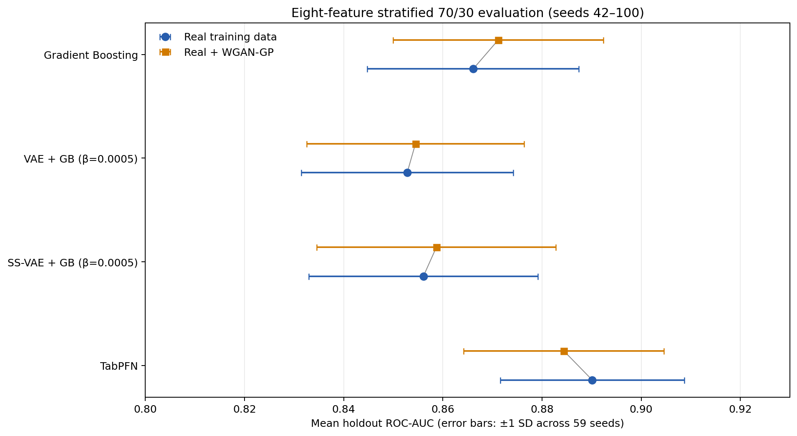

# Eight-feature gastric cancer experiments

This repository contains a repeated 70/30 holdout study of non-invasive gastric cancer classification using the eight predictors reported by Zhu et al. [1]. This README focuses on those eight-feature, stratified 70/30 experiments and their synthetic-data and TabPFN follow-ups.

## Dataset and predictors

The supplied cohort contains 709 records: 398 gastric cancer cases (`label=1`) and 311 non-cancer controls (`label=0`). The final model inputs are:

| Column | Meaning |
| --- | --- |
| `gender` | Binary gender code |
| `age` | Encoded age category (values 2–9 in this dataset; not continuous age in years) |
| `neu_lym` | Neutrophil-to-lymphocyte ratio (NLR) |
| `hb` | Hemoglobin |
| `alb` | Albumin |
| `cea` | Carcinoembryonic antigen |
| `ca125` | Cancer antigen 125 |
| `ca199` | Cancer antigen 19-9 |

The project reads the raw cohort from [`dataset/orginal_data/gastric_cancer_dataset_raw.csv`](dataset/orginal_data/gastric_cancer_dataset_raw.csv). In the repeated experiments, each seed creates a stratified split with 496 training records (70%) and 213 holdout records (30%). Seeds 42–100 produce 59 matched splits. All fitting and split-specific preprocessing occur within the training partition; the 30% holdout is used for that seed’s final model evaluation. Patients recur across different seeds, so these are repeated, overlapping resamples of one cohort, not 59 independent studies.

The fixed feature set follows the published eight-feature model. The source paper describes feature screening before its split; this project does not repeat feature selection inside every seed. The repository preprocessor flags extreme values (Hb >300, albumin >100, RDW >40) and imputes them using a five-cluster K-means fit, with preprocessing fitted on the current training partition. VAE inputs are scaled using the training partition. TabPFN receives the eight processed features in clinical units and uses its package defaults. Because this repository's age encoding differs from the source paper’s age-in-years description, results should be understood as a project reimplementation rather than an exact reproduction.

## Results figure

The plot summarizes mean holdout ROC-AUC ± one standard deviation over the same 59 seeds. These error bars show between-split variability; they are not confidence intervals. Use Experiment 12’s corrected paired tests for inferential comparisons.



## Repeated 70/30 classification results

Unless otherwise stated, values are mean holdout metric across 59 seeds (42–100). AUC is shown as mean ± standard deviation. The real-only GB row is the paper-parameter raw eight-feature baseline. WGAN rows use the matched seed-specific generator output from Experiment 10.

| Model condition | Beta | ROC-AUC mean ± SD | PR-AUC | Accuracy | F1 | Sensitivity | Specificity |
| --- | ---: | ---: | ---: | ---: | ---: | ---: | ---: |
| GB, real only (paper parameters) | — | **0.8661 ± 0.0213** | 0.9017 | 0.7852 | 0.8080 | 0.8044 | 0.7603 |
| GB + WGAN-GP | — | 0.8712 ± 0.0212 | 0.9060 | 0.7894 | 0.8070 | 0.7828 | 0.7979 |
| VAE + GB, real only | 0.0005 | 0.8528 ± 0.0214 | 0.8856 | 0.7703 | 0.7947 | 0.7908 | 0.7438 |
| VAE + GB + WGAN-GP | 0.0005 | 0.8545 ± 0.0219 | 0.8867 | 0.7701 | 0.7884 | 0.7616 | 0.7811 |
| SS-VAE + GB, real only | 0.0005 | 0.8561 ± 0.0231 | 0.8919 | 0.7762 | 0.7992 | 0.7912 | 0.7567 |
| SS-VAE + GB + WGAN-GP | 0.0005 | 0.8587 ± 0.0241 | 0.8954 | 0.7787 | 0.7955 | 0.7664 | 0.7946 |
| TabPFN, real only | — | **0.8901 ± 0.0186** | **0.9220** | **0.7972** | **0.8171** | **0.8048** | 0.7875 |
| TabPFN + WGAN-GP | — | 0.8844 ± 0.0202 | 0.9177 | 0.7926 | 0.8096 | 0.7836 | **0.8043** |

TabPFN on real-only training partitions had the highest mean AUC among these conditions. Its comparison with paper-parameter GB and the WGAN comparisons were assessed with the paired corrected tests below. Do not interpret the largest single-seed AUC as expected performance.

The raw-feature GB baseline uses 70 estimators, learning rate 0.12, maximum depth 5, and minimum leaf size 10, matching the paper-reported tree settings used by the project. VAE and SS-VAE models compress the eight predictors into four latent features; their encoder/decoder hidden widths are 128 and 64. SS-VAE also has a 32-unit classification head and supervised loss weight α=10. The latent-feature GB uses the project settings (200 estimators, learning rate 0.1, depth 4, minimum split 4, minimum leaf 2, square-root feature sampling). The beta parameter controls the VAE KL term.

Source summaries: [Experiment 5](results/experiment5/run_2026-11-03_18-27-50/metrics/summary_by_beta.csv), [Experiment 7](results/experiment7/run_2026-11-09_22-54-43/metrics/summary_by_beta.csv), [Experiment 8](results/experiment8/run_2026-11-09_23-28-46/metrics/summary.csv), [Experiment 10](results/experiment10/run_2026-11-10_02-14-37/metrics/summary.csv), and [Experiment 11](results/experiment11/run_2026-11-10_19-25-01/metrics/summary.csv).

### VAE beta sensitivity on real-only data

Experiments 5, 7, and 8 evaluated the beta values below on the same seed range. Beta sweeps are descriptive; Experiment 12 did not test every beta against every other beta.

| Model | Beta | Mean ROC-AUC ± SD | Mean PR-AUC |
| --- | ---: | ---: | ---: |
| VAE + GB | 0.0005 | 0.8528 ± 0.0214 | 0.8856 |
| VAE + GB | 0.005 | 0.8509 ± 0.0220 | 0.8847 |
| VAE + GB | 0.05 | 0.8469 ± 0.0222 | 0.8805 |
| VAE + GB | 0.5 | 0.8438 ± 0.0253 | 0.8759 |
| VAE + GB | 1.0 | 0.8211 ± 0.0309 | 0.8577 |
| SS-VAE + GB | 0.0005 | 0.8561 ± 0.0231 | 0.8919 |
| SS-VAE + GB | 0.005 | **0.8570 ± 0.0230** | **0.8922** |
| SS-VAE + GB | 0.05 | 0.8558 ± 0.0223 | 0.8894 |
| SS-VAE + GB | 0.5 | 0.8548 ± 0.0213 | 0.8870 |
| SS-VAE + GB | 1.0 | 0.8547 ± 0.0207 | 0.8869 |

### Corrected paired AUC comparisons (Experiment 12)

Experiment 12 reuses the saved per-seed results; it does not retrain models. Each comparison uses paired results from identical seed-specific patient splits. It applies a two-sided Nadeau–Bengio corrected resampled t-test and Holm adjustment across the five planned comparisons.

| Paired comparison (A − B) | Mean ΔAUC | Corrected 95% CI | Holm-adjusted p | Result at 0.05 |
| --- | ---: | ---: | ---: | --- |
| TabPFN real-only − GB real-only | +0.0240 | [+0.0077, +0.0403] | **0.0231** | TabPFN higher |
| GB + WGAN − GB real-only | +0.0051 | [−0.0132, +0.0233] | 1.0000 | Not significant |
| VAE + GB + WGAN − VAE + GB (β=0.0005) | +0.0017 | [−0.0275, +0.0309] | 1.0000 | Not significant |
| SS-VAE + GB + WGAN − SS-VAE + GB (β=0.0005) | +0.0026 | [−0.0183, +0.0235] | 1.0000 | Not significant |
| TabPFN + WGAN − TabPFN real-only | −0.0057 | [−0.0155, +0.0040] | 0.9807 | Not significant |

Interpretation: these runs show **no statistically reliable evidence of an AUC improvement from WGAN augmentation** in the four tested model comparisons. This does not prove the effect is exactly zero or establish equivalence. The corrected TabPFN-vs-GB comparison favors real-only TabPFN within this cohort and these splits. No external cohort was evaluated.

## Eight-feature synthetic-data experiments

### Experiment 9: compare generator approaches on one 70/30 split

Experiment 9 uses the fixed seed-42 processed split (496 training and 213 test records). It trains conditional WGAN-GP and a VAE decoder using only the training partition, and also creates SMOTE data. It compares synthetic and real feature distributions and nearest-neighbor distances; **it does not train a diagnostic classifier**. The train-proportion output has 218 controls and 278 cases; the balanced output has 248 of each. For this diagnostic, the held-out real partition is used as a fidelity reference, not to fit the generators.

| Synthetic method | Class-conditional KS ↓ | Wasserstein / train SD ↓ | Spearman correlation distance ↓ | Near-duplicate fraction ↓ |
| --- | ---: | ---: | ---: | ---: |
| WGAN-GP, training proportions | 0.1241 | 0.1188 | 0.8548 | 3.02% |
| WGAN-GP, balanced | 0.1348 | 0.1262 | 0.9529 | 4.03% |
| VAE decoder, training proportions | 0.1695 | 0.1478 | 1.4958 | 4.84% |
| VAE decoder, balanced | 0.1659 | 0.1514 | 1.4299 | 5.44% |
| SMOTE, training proportions | **0.1204** | **0.1081** | 0.9992 | 44.96% |
| SMOTE, balanced | 0.1212 | 0.1094 | 1.0002 | 44.35% |

Lower is closer for the first three distribution metrics. SMOTE has smaller marginal distances here but a much higher near-duplicate fraction. None of these metrics establishes clinical plausibility, privacy, or that training with synthetic rows improves prediction. See [Experiment 9 quality summaries](results/experiment9/run_2026-11-10_00-24-05/quality/synthetic_quality_summary.csv) and [feature-distribution plots](results/experiment9/run_2026-11-10_00-32-03/quality/).

The audit found no generated row exactly matching a real training row. It did find one exact synthetic-to-synthetic row pair in each SMOTE output; WGAN-GP and VAE outputs had no exact synthetic pairs.

### Experiment 10: WGAN-GP augmentation across 59 splits

For each seed 42–100, a conditional WGAN-GP is fitted on that seed’s real 70% training set and eight selected features. The generator uses latent dimension 16, hidden dimension 128, 5,000 generator steps, batch size 64, gradient-penalty weight 10, five critic updates per generator update, and Adam learning rates of 0.0001. `neu_lym`, `cea`, `ca125`, and `ca199` are log1p-transformed; transformations are fitted/applied within each training split and reversed for exported rows. The experiment produces as many synthetic records as real training records, with synthetic class counts reversed relative to the real training counts. Thus, real + synthetic data doubles the training size and balances the combined labels at 50/50. This design cannot isolate the synthetic-data effect from the effects of sample-size increase and class balancing.

Across the 59 generated datasets, mean class-conditional KS distance was 0.0811 (SD 0.0143); normalized Wasserstein distance was 0.0866 (SD 0.0165); and the Spearman correlation-matrix Frobenius distance was 0.5716 (SD 0.0570). There were no invalid gender or age values, negative biomarkers, or exact duplicates of training rows. The mean near-duplicate fraction was 4.25% (SD 1.34%) using the split-specific fifth-percentile real-to-real nearest-neighbor threshold. These are descriptive quality checks, not privacy or clinical-validity guarantees.

### Experiment 10/11 predictive comparison

Experiment 10 fits paper-parameter GB, VAE+GB, and SS-VAE+GB (β=0.0005) on the balanced real + synthetic training rows. Experiment 11 fits TabPFN using both the real-only training rows and the same seed-specific real + WGAN rows. All models are evaluated on the matching untouched 30% real holdout. Experiment 12 provides the paired significance analysis.

## TabPFN details and how to run Experiment 11

Experiment 11 uses the installed local `tabpfn` package, version **9.2.0**, and the default `TabPFNClassifier()` constructor with no parameter overrides. It does not use AutoTabPFN or a hosted client. The run records the complete estimator configuration in `tabpfn_configuration.json`. Python, NumPy, and PyTorch are seeded per split; PyTorch CPU threads are set to one by the config. The real and augmented conditions use the same eight features, same seed-specific split, same TabPFN defaults, and the same real test partition.

Artifacts: [TabPFN estimator configuration](results/experiment11/run_2026-11-10_19-25-01/tabpfn_configuration.json), [per-seed metrics](results/experiment11/run_2026-11-10_19-25-01/metrics/per_seed_metrics.csv), and [paired comparison summary](results/experiment11/run_2026-11-10_19-25-01/metrics/paired_comparison_summary.csv).

### Environment

This repository does not currently contain a pinned dependency/requirements file. In a Python environment compatible with the installed PyTorch and TabPFN versions, install the project packages, including the TabPFN version used for the reported run:

```bash
python3 -m venv .venv
source .venv/bin/activate
python -m pip install --upgrade pip
python -m pip install numpy pandas scipy scikit-learn pyyaml matplotlib torch tabpfn==9.2.0
```

The first TabPFN run may need to download the pretrained checkpoint. If the download service requires Hugging Face authentication, set `HF_TOKEN` in the shell environment before running. The experiment script does not load `.env` files automatically; keep credentials out of the repository and never commit a token.

### Run sequence

Experiment 11 reuses the seed-specific synthetic CSVs and split manifest created by Experiment 10. To regenerate those files and then rerun the TabPFN comparison:

```bash
python run.py --exp experiment10
python run.py --exp experiment11
```

Experiment 10 retrains a WGAN for each of 59 seeds and may take substantial CPU time. If the complete Experiment 10 artifacts for seeds 42–100 already exist, run only `python run.py --exp experiment11`. Experiment 11 checks each saved manifest against its own split before fitting. It writes a new timestamped run under `results/experiment11/`, including per-seed metrics, summary metrics, paired differences, split manifest, synthetic quality checks, and the TabPFN package version and parameters.

To inspect registered experiments:

```bash
python run.py --list
```

The saved Experiment 12 analysis can be run with `python run.py --exp experiment12` when the input paths in `experiments/configs/experiment12.yaml` point to the intended results. After new runs, update those paths to the new per-seed metrics and manifests before rerunning the significance analysis.

## Eight-feature experiment index

| Experiment | Purpose | Evaluation/data |
| --- | --- | --- |
| 5 | Raw eight-feature GB baseline and SS-VAE+GB beta sweep | 59 stratified 70/30 splits, seeds 42–100 |
| 7 | VAE+GB beta sweep | Same 59 splits |
| 8 | VAE+GB and SS-VAE+GB at β=1 | Same 59 splits |
| 9 | WGAN-GP vs VAE decoder vs SMOTE synthetic-data quality | Fixed seed-42 70/30 split; no diagnostic model |
| 10 | WGAN-GP generation and GB/VAE+GB/SS-VAE+GB on real + synthetic | 59 matched 70/30 splits |
| 11 | Default local TabPFN, real-only vs real + WGAN | Same saved 59 splits and synthetic rows |
| 12 | Corrected paired AUC tests; no model retraining | Saved 59-seed results from Experiments 5, 7, 10, and 11 |

## Repository structure

```text
major_project/
├── dataset/
│   ├── orginal_data/                 # Supplied patient-level source CSV
│   ├── split70_30/                   # Reusable seed-42 split and processed 8-feature files
│   └── synthetic_8_features/
│       └── experiment10/seed_<n>/     # Per-seed balanced WGAN rows + generation metadata
├── data_handling/
│   └── paper_preprocessing.py        # Paper-feature selection and train-fitted preprocessing
├── model_src/
│   ├── tree/                          # Gradient Boosting and other tree models
│   ├── VAE/                           # VAE and semi-supervised VAE implementations
│   ├── GAN/                           # WGAN-GP generator, critic, and training code
│   └── vae_pipeline.py
├── evaluation/                        # Metrics, reporting, plots, fidelity diagnostics
├── experiments/
│   ├── experiment5.py ... experiment12.py # Eight-feature 70/30 studies
│   ├── configs/                       # Run configuration YAML files
│   └── run.py                         # Experiment discovery/runner
├── results/
│   └── experiment5/ ... experiment12/ # Timestamped metrics, configs, manifests, figures
├── docs/figures/                      # README summary plot
├── preprocessing.py
├── train_test_split_pipeline.py
└── run.py                             # Root CLI entry point
```

The most useful detailed outputs are the per-seed metric CSVs and summary CSVs under each run’s `metrics/` folder, the split manifests under `splits/`, the saved WGAN rows and generation metadata under `dataset/synthetic_8_features/experiment10/`, and the corrected test table in [`results/experiment12/run_2026-11-11_22-22-03/metrics/corrected_significance_tests.csv`](results/experiment12/run_2026-11-11_22-22-03/metrics/corrected_significance_tests.csv).

## Source publication

1. Zhu SL, Dong J, Zhang C, Huang YB, Pan W. Application of machine learning in the diagnosis of gastric cancer based on noninvasive characteristics. *PLoS One*. 2020;15(12):e0244869. [doi:10.1371/journal.pone.0244869](https://doi.org/10.1371/journal.pone.0244869).

## Interpretation limits

These are retrospective holdout results from one small cohort, with overlapping patients across repeated seeds. They are not external validation and do not establish clinical utility or cancer-stage prediction. The fixed feature set and age encoding require confirmation against the source data and paper before a publication claim. WGAN augmentation changes both training-set size and class balance. Synthetic-data fidelity metrics do not establish clinical plausibility or privacy, and a non-significant test is not proof of no effect.
