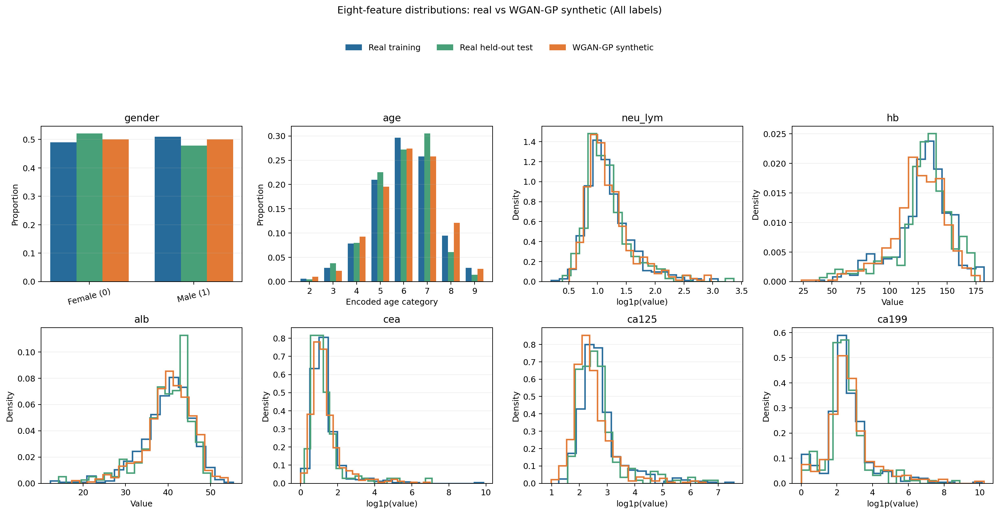
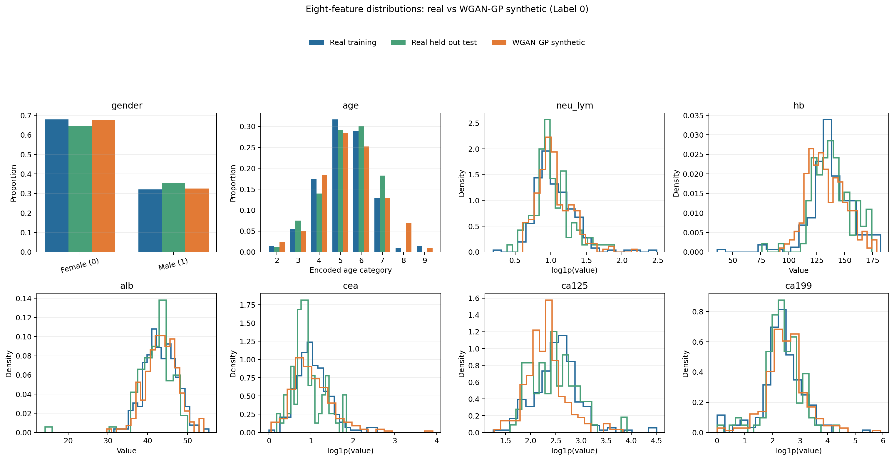
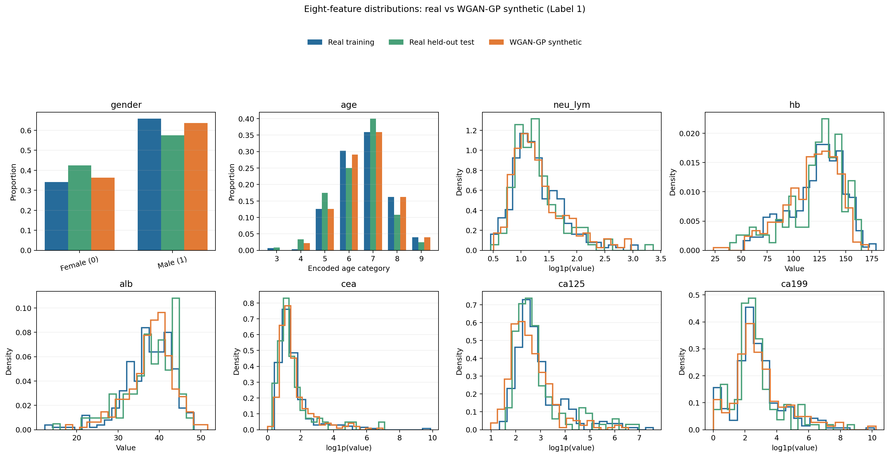

# Gastric Cancer Early Diagnostic Screening Pipeline

A modular machine learning and generative modeling framework for clinical diagnostic screening of gastric cancer using biochemical lab biomarkers.

---

## 🔬 Project Overview

This repository develops, benchmarks, and validates statistical, deep generative, and semi-supervised machine learning architectures for non-invasive gastric cancer detection.

### Dataset Overview
* **Cohort Size:** 709 total clinical patients (398 gastric cancer positive, 311 negative controls).
* **Biomarkers:** Complete blood counts (CBC), liver function enzymes, renal function markers, lipid profiles, and serum tumor markers (`CEA`, `CA19-9`, `CA125`, `CA724`).
* **Feature Engineering:** Log-transforms on heavy-tailed tumor markers and clinical prognostic ratios (`NLR`, `PLR`, `Hb-to-RDW`, `Atherogenic Index`, `Albumin-to-Bilirubin`).

---

## 🏛️ Architecture & Modules

```text
major_project/
├── dataset/                    # Clinical cohorts & synthetic data
│   ├── gastric_cancer_train.csv
│   ├── gastric_cancer_test.csv
│   ├── processed_dataset/      # Preprocessed train/test sets
│   └── synthetic_dataset/      # Generated WGAN-GP synthetic cohort
├── model_src/                  # Centralized model implementations
│   ├── tree/                   # Random Forest, AdaBoost, Gradient Boosting
│   ├── VAE/                    # Standard VAE & Semi-Supervised VAE
│   ├── GAN/                    # Conditional WGAN-GP (Generator & Critic)
│   └── vae_pipeline.py         # Sklearn-compatible VAE classifier wrapper
├── evaluation/                 # Modular evaluation engine
│   ├── metrics.py              # Pure statistical and mathematical metrics
│   ├── visualization.py        # ROC, PR, CM, and manifold projections
│   ├── reporting.py            # JSON/CSV result serializers
│   ├── classification_evaluation.py
│   ├── VAE_evalution.py
│   └── synthetic_fidelity.py   # KS-tests, Frobenius distance, TSTR, memorization
├── experiments/                # Config-driven experiment runner
│   ├── base_experiment.py      # Abstract base class for reproducible runs
│   ├── configs/                # YAML configuration files
│   ├── experiment1.py          # Baseline Trees vs. VAE + Trees
│   ├── experiment2.py          # WGAN-GP Augmented Multi-Seed & Multi-Beta Study
│   └── experiment3.py          # Semi-Supervised VAE vs. Baseline Models
├── results/                    # Versioned, timestamped experimental runs
├── run.py                      # Unified CLI entry point
└── resultofss_vaetest.md       # Summary of Semi-Supervised VAE findings
```

---

## 🚀 Running Experiments

All experiments are config-driven and executed via the unified CLI runner:

```bash
# 1. View all available registered experiments
python3 run.py --list

# 2. Run Experiment 1 (Baseline GB vs. VAE + GB)
python3 run.py --exp experiment1

# 3. Run Experiment 2 (WGAN-GP Augmented Multi-Seed & Multi-Beta Benchmark)
python3 run.py --exp experiment2

# 4. Run Experiment 3 (Semi-Supervised VAE vs. Gradient Boosting)
python3 run.py --exp experiment3
```

Results, metrics summaries, and plots are automatically saved in versioned folders under `results/<experiment>/run_<timestamp>/`.

---

## 📊 Summary of Research Findings

### 1. Semi-Supervised VAE Breakthrough (`experiment3`)
Standard unsupervised VAE compression created an information bottleneck ($\text{ROC-AUC} \approx 0.72$). Introducing multi-task joint supervision ($\mathcal{L}_{\text{Recon}} + \beta\mathcal{L}_{\text{KL}} + \alpha\mathcal{L}_{\text{BCE}}$) aligned the 8-dimensional latent space with the cancer diagnostic manifold, yielding a **+11.5% ROC-AUC leap**:

| Model Condition | ROC-AUC | PR-AUC | Accuracy | Specificity |
| :--- | :---: | :---: | :---: | :---: |
| **Baseline GB (Raw Features)** | **0.8569 ± 0.0033** | **0.8839 ± 0.0019** | 0.7507 ± 0.0080 | 0.7429 ± 0.0143 |
| **Standard VAE + GB (Unsupervised Z)** | 0.7196 ± 0.0307 | 0.7246 ± 0.0316 | 0.6775 ± 0.0390 | 0.7343 ± 0.0260 |
| **SS-VAE + GB (Supervised Z)** | **0.8349 ± 0.0097** | 0.8300 ± 0.0146 | **0.7549 ± 0.0104** | 0.7571 ± 0.0101 |
| **SS-VAE End-to-End Neural Net** | **0.8330 ± 0.0111** | **0.8459 ± 0.0151** | 0.7479 ± 0.0031 | **0.7886 ± 0.0538** |

*For complete details, see [`resultofss_vaetest.md`](resultofss_vaetest.md).*

### 2. Matched 70/30 holdout seed sweeps (Experiments 5, 7, and 8)

Experiments 5 and 7 evaluate the paper's eight selected features on **59 stratified 70/30 splits**, using seeds 42 through 100. For each seed, preprocessing and model fitting use the 70% training partition, and ROC-AUC is measured on that seed's held-out 30%. The raw-feature Gradient Boosting (GB) baseline is paired with Experiment 5's SS-VAE results. Experiment 8 compares VAE+GB and SS-VAE+GB at beta 1.0 on the same seed range. Values below are mean holdout ROC-AUC ± standard deviation across seeds; “best” is the highest single-seed holdout AUC.

| Model | Beta | Mean holdout ROC-AUC ± SD | Best holdout AUC (seed) |
| :--- | ---: | ---: | ---: |
| Raw eight-feature GB | — | **0.8661 ± 0.0213** | **0.9104 (93)** |
| SS-VAE + GB | 0.0005 | 0.8561 ± 0.0231 | 0.9074 (85) |
| SS-VAE + GB | 0.005 | 0.8570 ± 0.0230 | 0.9041 (51) |
| SS-VAE + GB | 0.05 | 0.8558 ± 0.0223 | 0.9002 (51) |
| SS-VAE + GB | 0.5 | 0.8548 ± 0.0213 | 0.9044 (52) |
| VAE + GB | 0.0005 | 0.8528 ± 0.0214 | 0.9005 (93) |
| VAE + GB | 0.005 | 0.8509 ± 0.0220 | 0.9022 (93) |
| VAE + GB | 0.05 | 0.8469 ± 0.0222 | 0.8973 (91) |
| VAE + GB | 0.5 | 0.8438 ± 0.0253 | 0.8927 (78) |
| SS-VAE + GB | 1.0 | 0.8547 ± 0.0207 | 0.8924 (90) |
| VAE + GB | 1.0 | 0.8211 ± 0.0309 | 0.8734 (78) |

The raw eight-feature GB baseline has the highest mean holdout AUC in these comparisons. The best single split is not the same as the average result, so the maximum should not be presented as the expected performance. Experiment 8 has no separate beta-independent raw GB row; its GB comparator is reported in Experiment 5.

Saved per-seed and summary metrics:

* [Experiment 5: SS-VAE beta sweep and matched raw GB baseline](results/experiment5/run_2026-11-03_18-27-50/metrics/summary_by_beta.csv)
* [Experiment 7: VAE beta sweep](results/experiment7/run_2026-11-09_22-54-43/metrics/summary_by_beta.csv)
* [Experiment 8: beta 1.0 comparison](results/experiment8/run_2026-11-09_23-28-46/metrics/summary.csv)

### 3. Eight-feature synthetic data generation and quality checks (Experiment 9)

Experiment 9 uses the existing processed-and-selected **70/30 split**: 496 training rows (218 class 0, 278 class 1) and 213 held-out test rows. Generator fitting uses only the 70% training partition. The held-out test partition is used as a real-data reference for fidelity statistics and is not used to fit or tune a generator. The eight generated predictors are `gender`, `age`, `neu_lym`, `hb`, `alb`, `cea`, `ca125`, and `ca199`; `label` conditions the WGAN and is included with each output row.

Three synthetic-data approaches were compared: conditional WGAN-GP, a VAE decoder with class-conditional latent sampling, and SMOTE as an interpolation baseline. Each produced a 496-row train-proportion set (218/278 by class) and a 496-row balanced set (248/248). No GB, diagnostic classifier, or TSTR model was trained in this experiment.

For generator training, `neu_lym`, `cea`, `ca125`, and `ca199` were transformed with `log1p`; a standard scaler was fitted on the training data only. Generated values were inverse-transformed to clinical units. Postprocessing enforced binary gender, integer-coded age, and nonnegative biomarkers. Files and settings are recorded in [`generation_metadata.json`](dataset/synthetic_8_features/generation_metadata.json). The earlier untransformed generation outputs are retained in [`untransformed_v1/`](dataset/synthetic_8_features/untransformed_v1/).

| Method/output | Mean class-conditional KS ↓ | Mean Wasserstein distance in train SD ↓ | Spearman correlation distance ↓ | Exact train duplicates | Near-duplicate fraction* |
| :--- | ---: | ---: | ---: | ---: | ---: |
| WGAN-GP, training class proportions | 0.1241 | 0.1188 | 0.8548 | 0 | 3.02% |
| WGAN-GP, balanced classes | 0.1348 | 0.1262 | 0.9529 | 0 | 4.03% |
| VAE decoder, training class proportions | 0.1695 | 0.1478 | 1.4958 | 0 | 4.84% |
| VAE decoder, balanced classes | 0.1659 | 0.1514 | 1.4299 | 0 | 5.44% |
| SMOTE, training class proportions | 0.1204 | 0.1081 | 0.9992 | 0 | 44.96% |
| SMOTE, balanced classes | 0.1212 | 0.1094 | 1.0002 | 0 | 44.35% |

Lower is closer for the first three metrics. KS and Wasserstein summarize feature-wise marginal differences by class; the Wasserstein values are normalized by each feature's training standard deviation. Spearman correlation distance is the Frobenius distance between real and synthetic rank-correlation matrices. “Near duplicate” means a synthetic row's standardized nearest-training-row distance is at or below the 5th percentile of real training rows' nearest-neighbor distances. No exact row duplicates were found. SMOTE matches marginal distributions reasonably closely but has a much higher near-duplicate fraction, consistent with interpolation close to training records. These are statistical fidelity and novelty checks, not evidence of clinical validity or proof that synthetic data improves prediction.

Quality summary: [`synthetic_quality_summary.csv`](dataset/synthetic_8_features/synthetic_quality_summary.csv). Feature-level results: [`class_conditional_marginal_metrics.csv`](dataset/synthetic_8_features/class_conditional_marginal_metrics.csv).






